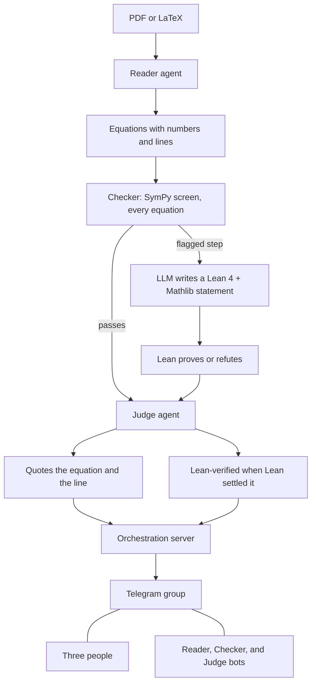

# Sanity

Sanity finds mathematical mistakes in the equations of a scientific paper. Three agents do the work. A language model never gets the last word: a step stands only if symbolic math agrees, and a flagged step can be settled by a proof.

A Reader takes a PDF or a LaTeX source and lifts each displayed equation with its number and source line. A Checker re-derives the step in SymPy (algebra, dimensions, limits, special cases). SymPy screens every equation. For a flagged step, the Checker has an LLM write the claim as a Lean 4 statement with Mathlib, and Lean proves or refutes it. A Judge confirms or rejects the flag, quotes the equation and the line, and marks the ruling Lean-verified when Lean settled it. That is the strongest evidence it will attach.

Three people watch and steer in a Telegram group with the three Hermes agents. Bots in a group cannot see each other's messages, so a server hands work from one agent to the next. See [docs/telegram.md](docs/telegram.md).

The site in `site/` is a one-page demo with example data and two planted errors. It is not a check of a real paper.

## Architecture



The group is the human view. The server is the handoff. Lean-verified outranks a SymPy flag. A SymPy pass does not go to Lean.

## Repository

```
site/     one-page demo
brand/    logo, mark, favicon
agents/   reader, checker (SymPy + Lean), judge
docs/     Telegram plan
```

The root of the repo is this file, `LICENSE`, `.gitignore`, and those directories.

## Run the site

Node.js 22 is enough.

```bash
cd site
npm install
npm run dev
```

The dev server listens on port 4317. Open [http://127.0.0.1:4317](http://127.0.0.1:4317).

```bash
cd site
npm run build
```

`npm run build` writes a static site to `site/dist`. `npm run preview` serves that build, also on port 4317.

## Run the SymPy check

From the repository root:

```bash
python3 -m pip install -r agents/checker/requirements.txt
python3 -m pytest agents/checker
```

Or, without pytest, print the two planted flags:

```bash
python3 agents/checker/check_step.py
```

The test integrates `m v dv + k x dx = 0` and checks that a paper energy missing the `1/2` on `k x²` does not match. It also checks that `tau = b/m` is not a time.

Saved checks live in `agents/checker/verify/checks/`, one script per equation. The model may draft a script. A verdict counts only if that script printed it. From the repository root:

```bash
python3 agents/checker/verify_run.py
```

The specimen includes the two planted errors, so this command exits 1. `Lean-PROVED` is the strongest verdict, above a symbolic pass. The procedure for the Checker is [skills/verify-math/SKILL.md](skills/verify-math/SKILL.md). A run writes `PLAN.md` and waits for approval before adding checks.

## Lean specimen

`agents/checker/lean` is a prelude-only Lean 4 package: one theorem, no Mathlib. With [elan](https://github.com/leanprover/elan) installed:

```bash
cd agents/checker/lean
lake build
```

Notes: [agents/checker/lean/NOTES.md](agents/checker/lean/NOTES.md). Do not build Mathlib in CI.

## Acknowledgements

The Checker's rule that a verdict exists only if an executed script printed it, the names `VERIFIED`, `VERIFIED-NUMERICALLY`, `FAILED` and `UNCHECKED`, and the runner that writes `RESULTS.md` are adapted from claude-mathematician by Konstantin Gerbig (MIT, copyright 2026 Konstantin Gerbig). See [agents/checker/NOTICE](agents/checker/NOTICE). Sanity adds `Lean-PROVED` above those verdicts and does not use Mathematica.

## License

[MIT](LICENSE).
