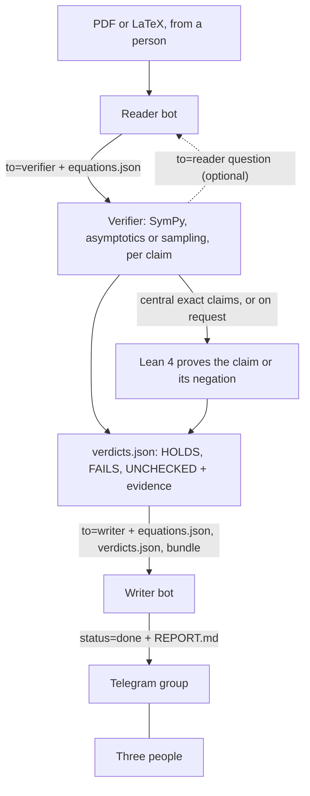

# Sanity

Sanity checks the equations in a paper. A Reader lifts each displayed equation. A Verifier re-derives it in SymPy, and can add a Lean proof when the claim can be stated. A Writer turns those script verdicts into a report. A verdict exists only if a check script printed it: `HOLDS`, `FAILS`, or `UNCHECKED`. The Writer does not change one.

The three bots share one Telegram group and talk to each other there. Bot-to-Bot Communication Mode is on, so a bot sees the others' messages. Each machine message starts with `sanity run=<slug>` and names who should act with `to=<role>` (`to=reader`, `to=verifier`, `to=writer`). The Verifier posts a plan and a time estimate at the start of a run, before any check, then one handoff `to=writer` when the verdicts are in. Files travel as Telegram attachments; each bot keeps its own working copies. The whole message protocol is the shared skill [skills/sanity-protocol/SKILL.md](skills/sanity-protocol/SKILL.md). See also [agents/verifier/AGENT.md](agents/verifier/AGENT.md) and [docs/setup-verifier-docker.md](docs/setup-verifier-docker.md).

On [arXiv:2410.11128v1](https://arxiv.org/abs/2410.11128v1), Eq. (4.4) prints the wrong horizon angular velocity. Sanity flags it and proposes the same replacement the authors later recorded. The run is [runs/arxiv-2410-11128/](runs/arxiv-2410-11128/). The page is <https://ilkhamfy.github.io/sanity/demo.html>.

`runs/example-oscillator/` is a toy note with two planted errors. The front page plays that note.

## Architecture



The group is the handoff: every message names its target with `to=<role>`, and files travel as attachments. A status line has no `to=`, so it wakes no bot. Lean is extra evidence for a few central exact claims, always after SymPy: a Lean `proof` or `refutation` outranks a SymPy result for the same claim. The Writer does not get a vote on the verdict.

## Roles

| Agent | Produces (sent in the group) | Does not |
| --- | --- | --- |
| Reader | `equations.json`, to the Verifier | check, judge, or edit the paper |
| Verifier | `verdicts.json` and an evidence bundle (checks, `PLAN.md`, `RESULTS.md`), to the Writer | open the paper, edit the extraction, or write the report |
| Writer | `REPORT.md` and its summary, to the group (`status=done`) | change a verdict, or check the math itself |

Role prompts: `agents/reader/AGENT.md`, `agents/verifier/AGENT.md`, `agents/writer/AGENT.md`.

## Repository

```
site/      front page, and the paper check at demo.html
brand/     logo, mark, favicon
agents/    reader, verifier (SymPy + Lean), writer
docs/      Telegram, handoff, setup, schemas
hermes/    example profile per role, no tokens
runs/      worked examples, used by the tests
scripts/   configure_bot (any bot), setup_verifier_docker, setup_bot
skills/    verify-math, sanity-protocol
```

## Quickstart

Node.js 22 is enough for the site. Python 3 is enough for the checks. A ten-minute checklist for each person, including the bot assignment, is [docs/setup.md](docs/setup.md).

```bash
cd site
npm install
npm run dev
```

The dev server listens on port 4317. Open [http://127.0.0.1:4317](http://127.0.0.1:4317).

```bash
cd site
npm run build
```

`npm run build` writes a static site to `site/dist`. `npm run preview` serves that build, also on port 4317. The Vite `base` is `./`, for GitHub Pages.

From the repository root, install the Verifier's dependencies and run the tests:

```bash
python3 -m pip install -r agents/verifier/requirements.txt
python3 -m pytest agents/verifier agents/writer scripts
```

Or print the two planted flags:

```bash
python3 agents/verifier/check_step.py
```

Saved checks for the specimen live in `runs/example-oscillator/verify/checks/`, one script per equation. The model may draft a script. A verdict counts only if that script printed it.

```bash
python3 agents/verifier/verify_run.py runs/example-oscillator/verify
```

The specimen includes the two planted errors, so this command exits 1. It writes `RESULTS.md` and `verdicts.json`, which the Writer reads. The procedure for the Verifier is [skills/verify-math/SKILL.md](skills/verify-math/SKILL.md). The Writer's report for this note is [runs/example-oscillator/REPORT.md](runs/example-oscillator/REPORT.md).

The Kerr run fails the same way, on Eq. (4.4):

```bash
python3 agents/verifier/verify_run.py runs/arxiv-2410-11128/verify
```

To set up your own bot, from the repo root, with `HERMES_PROFILE_DIR` pointed at the profile path you want:

```bash
HERMES_PROFILE_DIR="$HOME/.hermes/profiles/sanity-reader" bash scripts/setup_bot.sh reader
```

Use `verifier` or `writer` for the other roles. Windows: `scripts/setup_bot.ps1`. The script clones or pulls, creates a venv, installs the requirements, and copies `hermes/<role>/` plus the role's `AGENT.md`. It then prints the remaining BotFather steps. Details: [docs/setup.md](docs/setup.md).

## How to add your bot

1. Create one bot with [@BotFather](https://t.me/BotFather). One token, one role.
2. `/setprivacy` → Disable, and switch on Bot-to-Bot Communication Mode. Remove the bot from the group and add it again.
3. Lock it to the three teammates' Telegram user IDs, the two other bots and the group. Placeholders live in `hermes/<role>/env.example`. Do not commit a token.
4. Run `scripts/setup_bot.sh` or `scripts/setup_bot.ps1` for that role. It copies the example profile and installs `agents/<role>/AGENT.md` as `SOUL.md`. The profile loads `skills/verify-math` and `skills/sanity-protocol`.
5. Replace `${SANITY_REPO}` and the model placeholders in the copied `config.yaml`.
6. Start that profile's gateway. In the group, a person talks to the bot, or another bot sends `sanity run=<slug> to=<role>`. The Verifier answers with the plan and the estimate, then checks.

### Configure your bot for the protocol

After the steps above, one command sets everything the bots need to talk to each other: the role's persona, the shared protocol skill [skills/sanity-protocol/SKILL.md](skills/sanity-protocol/SKILL.md), the `to=<role>` wake word, mention-only, the group target, the loop guard, and who may approve commands. Run it from an up-to-date clone, with the Telegram IDs of the three people:

```bash
git pull
APPROVERS=<id>,<id>,<id> bash scripts/configure_bot.sh reader     # or writer, verifier
```

Hermes in Docker: add `HERMES_CONTAINER=<name> SANITY_REPO=<repo path inside the container>`. A Hermes profile: add `HERMES_PROFILE=<name>`. `KEEP_SOUL=1` keeps your own persona. The script backs up `SOUL.md`, `config.yaml` and `.env`, restarts the gateway, and ends with a check. The Verifier in Docker uses `bash scripts/setup_verifier_docker.sh install`, then `APPROVERS=<id>,<id>,<id> bash scripts/setup_verifier_docker.sh configure`, which runs the same script ([docs/setup-verifier-docker.md](docs/setup-verifier-docker.md)).

Two steps stay manual: in @BotFather, switch on Bot-to-Bot Communication Mode for the bot, and list the three people, the two other bots and the group in `TELEGRAM_ALLOWED_USERS`. To see what is still missing, without changing anything:

```bash
bash scripts/configure_bot.sh check reader     # or writer, verifier
```

Group setup: [docs/telegram.md](docs/telegram.md). The Verifier's messages: [agents/verifier/AGENT.md](agents/verifier/AGENT.md).

## Lean specimen

`agents/verifier/lean` is a prelude-only Lean 4 package: one theorem, no Mathlib. With [elan](https://github.com/leanprover/elan) installed:

```bash
cd agents/verifier/lean
lake build
```

Notes: [agents/verifier/lean/NOTES.md](agents/verifier/lean/NOTES.md). Do not build Mathlib in CI.

## Acknowledgements

The Verifier's rule that a verdict exists only if an executed script printed it, the original verdict names (`VERIFIED`, `VERIFIED-NUMERICALLY`, `FAILED`, `UNCHECKED`, now replaced by `HOLDS`/`FAILS`/`UNCHECKED` plus an evidence kind), and the runner that writes `RESULTS.md` are adapted from claude-mathematician by Konstantin Gerbig (MIT, copyright 2026 Konstantin Gerbig). See [agents/verifier/NOTICE](agents/verifier/NOTICE). Sanity adds Lean and `verdicts.json`, and does not use Mathematica.

## License

[MIT](LICENSE).
